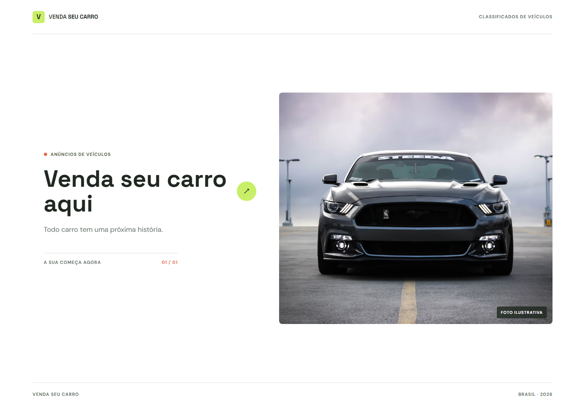

# Venda seu carro

Aplicação de portfólio para cadastrar anúncios de veículos e consultar os
anúncios salvos no próprio navegador.

## Demonstração

[Acesse a versão publicada no GitHub Pages](https://joycesantosp03-jpg.github.io/venda-seu-carro-react/).

O site é atualizado automaticamente quando novas alterações são enviadas para
a branch `main`.

## Captura de tela



## Funcionalidades

- Formulário com validação de dados, opcionais e câmbio.
- Seleção de até cinco fotos JPG, PNG ou WebP, limitadas a 5 MB cada.
- Persistência local de anúncios e imagens usando IndexedDB.
- Migração automática de anúncios existentes no `localStorage`.
- Layout adaptável para telas menores.

## Tecnologias

- React
- JavaScript
- CSS
- IndexedDB do navegador

## Como executar

Requer Node.js e npm instalados.

```bash
npm install
npm run dev
```

Para gerar e visualizar a versão de produção:

```bash
npm run build
npm run preview
```

## Limitações

Os anúncios e as imagens ficam somente no navegador e no dispositivo em que
foram cadastrados. Eles não são enviados a um servidor, não são compartilhados
com outros usuários e podem ser apagados ao limpar os dados do navegador.
Este projeto é uma demonstração de front-end, não um serviço de classificados
com publicação pública.
